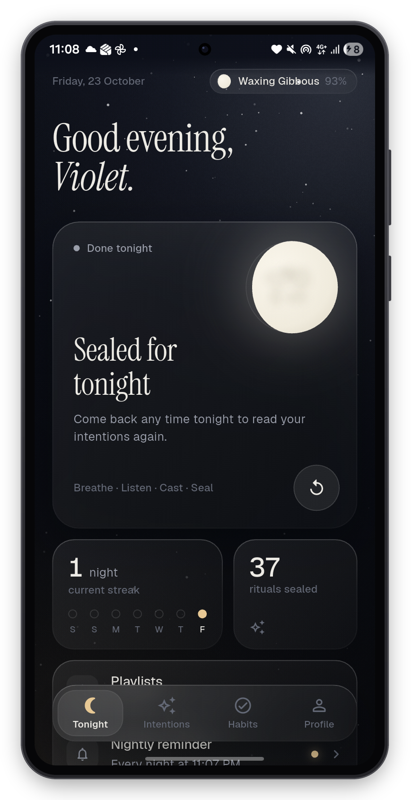
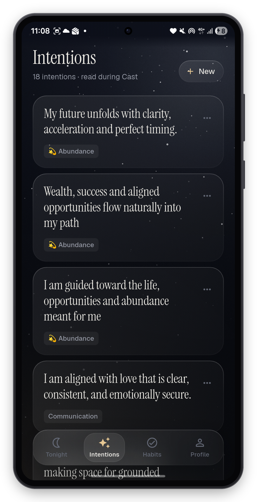
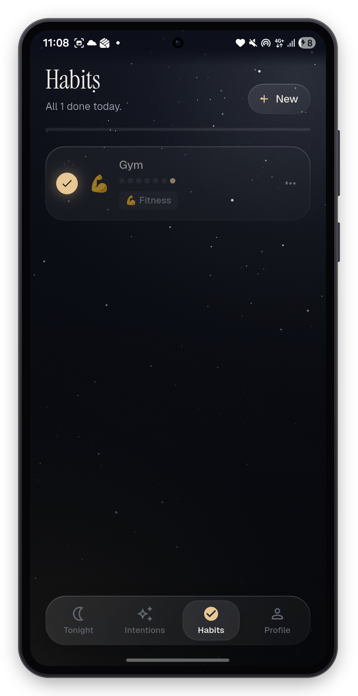
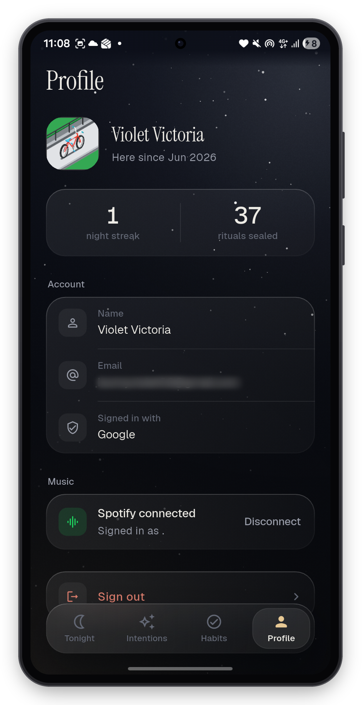

<div align="center">

<br/>


<br/><br/>

<h1>☾ ⋆⁺₊✧ nightly ritual ✧₊⁺⋆ ☾</h1>

<p>
  <b>˚₊‧꒰ა ☆ ໒꒱ ‧₊˚</b>
  <br/>
  <i>a dreamy manifestation companion for moonlit evenings</i>
  <br/>
  <b>𐙚₊˚⊹♡ made for soft rituals, lucky girls & future selves ♡⊹˚₊𐙚</b>
</p>

<br/>

<pre>
⋆｡ﾟ☁︎｡⋆｡ ﾟ☾ ﾟ｡⋆

　　　∧＿∧
　　（｡･ω･｡)つ━☆・*。
　　⊂　 ノ 　　　・゜+.
　　しーＪ　　　°。+ *´¨)
　　　　　　　　.· ´¸.·*´¨) ¸.·*¨)
　　　　　　　　　(¸.·´ (¸.·'* ✨

　　　make a wish, starlight ✦
</pre>

<br/>


<br/><br/>

<blockquote>
  <i>seal your intentions beneath the stars, one beautiful night at a time</i> ✨
</blockquote>

<br/>

</div>

---

<div align="center">

<h2>｡ﾟ•┈୨♡୧┈•ﾟ｡</h2>
<h3>୨୧ what is nightly ritual? ୨୧</h3>
<h2>｡ﾟ•┈୨♡୧┈•ﾟ｡</h2>

</div>

<br/>

<p align="center">
  <b>Nightly Ritual</b> is a cozy manifestation app that turns your bedtime routine into a soft little ceremony.
</p>

<p align="center">
  It helps you slow down, breathe, listen to dreamy ritual audios, write your intentions, track your habits, and reflect under the moon.
</p>

<div align="center">

<pre>
╭───────────── ⊹₊⟡⋆ ─────────────╮

    🌙 moon lovers
    💜 dreamers
    ✨ lucky girls
    🦋 future selves
    🌿 healing journeys
    ☁️ soft evenings

╰───────────── ⊹₊⟡⋆ ─────────────╯
</pre>

</div>

<p align="center">
  <i>little rituals become beautiful lives</i> ☾
</p>

---

<div align="center">

<h2>₊˚⊹♡ ⋆｡˚ ☾ ˚｡⋆ ♡⊹˚₊</h2>
<h3>✦ a peek inside ✦</h3>
<h2>₊˚⊹♡ ⋆｡˚ ☾ ˚｡⋆ ♡⊹˚₊</h2>

<br/>






<br/>

<sub><i>tonight ✦ intentions ✦ habits ✦ profile</i></sub>

</div>

---

<div align="center">

<h2>⋆｡ﾟ☁︎｡⋆｡ ﾟ☾ ﾟ｡⋆</h2>
<h3>✦ the nightly ritual ✦</h3>
<h2>⋆｡ﾟ☁︎｡⋆｡ ﾟ☾ ﾟ｡⋆</h2>

</div>

<br/>

<div align="center">


</div>

<br/>

<div align="center">

| Step | Ritual        | Description                       | Energy    |
| ---- | ------------- | --------------------------------- | --------- |
| 🌬   | **Breathe**   | 4-7-8 breathing cycles            | calm      |
| 🎧   | **Frequency** | manifestation audio & subliminals | alignment |
| ✨   | **Cast**      | affirmations & intentions         | creation  |
| 🕯   | **Seal**      | gratitude & reflection            | trust     |

</div>

---

<div align="center">

<h2>˚₊‧꒰ა ☆ ໒꒱ ‧₊˚</h2>
<h3>⋆𐙚₊˚⊹♡ magical little features ♡⊹˚₊𐙚⋆</h3>
<h2>˚₊‧꒰ა ☆ ໒꒱ ‧₊˚</h2>

</div>

<br/>

<h3>🌙 lunar companion</h3>

<p>
Track the real moon phase and illumination percentage every night, so your ritual always feels connected to the sky.
</p>

<div align="center">

<pre>
╭───────────── ⊹₊⟡⋆ ─────────────╮

🌑 New Moon
🌒 Waxing Crescent
🌓 First Quarter
🌔 Waxing Gibbous
🌕 Full Moon
🌖 Waning Gibbous
🌗 Last Quarter
🌘 Waning Crescent

╰───────────── ⊹₊⟡⋆ ─────────────╯
</pre>

</div>

<p align="center">
  <i>because every ritual deserves moonlight</i> ( ˘͈ ᵕ ˘͈♡)
</p>

---

<h3>🔥 ritual streaks</h3>

<p>
Track your consistency with soft little progress counters.
</p>

<div align="center">

<pre>
╭───────────── ⊹₊⟡⋆ ─────────────╮

🔥 current streak
✨ spells cast
🌙 rituals completed
💜 nights returned to yourself

╰───────────── ⊹₊⟡⋆ ─────────────╯
</pre>

</div>

<p align="center">
  <i>do it for future you, she is already glowing</i> ✧
</p>

---

<h3>💜 manifestation journal</h3>

<p>
Capture wishes, affirmations, synchronicities, reflections, gratitude notes, and tiny signs from the universe.
</p>

<div align="center">

<pre>
╭───────────── ⊹₊⟡⋆ ─────────────╮

🌙 moon work
💜 self concept
✨ manifestation
🦋 transformation
🌸 beauty
💰 abundance
👑 confidence
🌿 healing
🔮 intuition
🌊 detachment
🙏 gratitude

╰───────────── ⊹₊⟡⋆ ─────────────╯
</pre>

</div>

---

<h3>🎧 cosmic frequencies</h3>

<p>
Instead of a strict Spotify connection, Nightly Ritual gives users a dreamy audio library filled with manifestation and subliminal collections.
</p>

<div align="center">

<pre>
╭───────────── ⊹₊⟡⋆ ─────────────╮

🌙 moon manifestation
💜 self concept reset
💰 abundance magnet
🌸 glow up subliminal
👑 divine feminine
🌿 healing frequencies
🦋 highest self
🌊 detachment & flow
😴 sleep manifestation
✨ lucky girl syndrome
☁️ soft piano affirmations
🕯 guided visualization

╰───────────── ⊹₊⟡⋆ ─────────────╯
</pre>

</div>

<p align="center">
  <i>put on your headphones and let the universe do the rest</i> 🎧✨
</p>

---

<h3>✅ tiny habit garden</h3>

<p>
Create gentle habits that support your dream life without harsh productivity pressure.
</p>

<div align="center">

<pre>
╭───────────── ⊹₊⟡⋆ ─────────────╮

🌙 evening
🌅 morning
💜 self-care
🧘 mindfulness
📖 learning
🌿 wellness
😴 sleep
🥗 nourishment
🕯 ritual

╰───────────── ⊹₊⟡⋆ ─────────────╯
</pre>

</div>

<p align="center">
  <i>soft consistency is still consistency</i> ୨୧
</p>

---

<h3>🌟 starry animated background</h3>

<p>
A dreamy animated night sky sits behind the ritual experience.
</p>

<div align="center">

<pre>
✦ 150 twinkling stars
☄ occasional shooting stars
🌙 moonlit atmosphere
✨ magical animations
☁ dreamy gradients
💜 soft glows
</pre>

</div>

<p align="center">
  <i>atmosphere is everything</i> (っ˘ω˘ς )
</p>

---

<div align="center">

<h2>•─────────✦❀✦────────•</h2>
<h3>☾ design language ☾</h3>
<h2>•─────────✦❀✦────────•</h2>

</div>

<br/>

<div align="center">

<pre>
╔══════════════════════════════════════════╗
║                                          ║
║  Night Ink        #07080B                ║
║  Raised Ink       #0E1016                ║
║  Candlelight      #E7C894                ║
║  Moon Surface     #F0EBDD                ║
║  Parchment Text   #EDEBE5                ║
║  Ember Coral      #E0806F  (destructive) ║
║                                          ║
╚══════════════════════════════════════════╝
</pre>

</div>

<div align="center">

<pre>
☾ Instrument Serif headlines, Geist for everything else
✦ frosted glass with light-catching edges
☾ a living sky: twinkling stars, moon glow, grain
✦ one warm accent: candlelight on ink
☾ the real moon phase, drawn to tonight's terminator
✦ press-to-shrink feedback & staggered reveals
♡ spring-physics intention cards
୨୧ respects reduce motion & high contrast
</pre>

</div>

---

<div align="center">

<h2>───── ⋆⋅☆⋅⋆ ─────</h2>
<h3>✦ tech stack ✦</h3>
<h2>───── ⋆⋅☆⋅⋆ ─────</h2>

</div>

<br/>

<div align="center">

| Layer               | Magic                                            |
| ------------------- | ------------------------------------------------ |
| 📱 Interface        | Flutter 3.x + Material 3                         |
| ☁️ Dream Archive    | Cloud Firestore                                  |
| 🔐 Identity         | Firebase Auth                                    |
| 🌙 Lunar Magic      | Real Moon Phase Calculations                     |
| 🎧 Ritual Library   | Manifestation Playlists & Subliminal Collections |
| 🔔 Gentle Reminders | Local Notifications                              |
| ✨ Memory Crystals  | SharedPreferences                                |
| 🔮 Secret Keys      | flutter_dotenv                                   |

</div>

---

<div align="center">

<h2>₊˚⊹♡ getting started ♡⊹˚₊</h2>

</div>

<br/>

<h3>1. clone the repository</h3>

```bash
git clone <your-repo-url>
cd nightly_ritual
```

<h3>2. create your .env file</h3>

```env
# Firebase
FIREBASE_API_KEY=
FIREBASE_APP_ID_ANDROID=
FIREBASE_MESSAGING_SENDER_ID=
FIREBASE_PROJECT_ID=
FIREBASE_STORAGE_BUCKET=
FIREBASE_AUTH_DOMAIN=

# Ritual Audio / Playlist Links
YOUTUBE_PLAYLIST_URL=
SPOTIFY_PLAYLIST_URL=
```

<h3>3. install dependencies</h3>

```bash
flutter pub get
```

<h3>4. run the app</h3>

```bash
flutter run
```

---

<div align="center">

<h2>˚₊‧꒰ა ☆ ໒꒱ ‧₊˚</h2>
<h3>୨୧ project structure ୨୧</h3>
<h2>˚₊‧꒰ა ☆ ໒꒱ ‧₊˚</h2>

</div>

```bash
nightly_ritual/
│
├── lib/
│   ├── main.dart
│   │
│   ├── models/
│   │   ├── manifestation_ritual.dart
│   │   ├── habit.dart
│   │   └── playlist_entry.dart
│   │
│   ├── pages/
│   │   ├── rituals_page.dart
│   │   ├── habits_page.dart
│   │   └── profile_page.dart
│   │
│   ├── services/
│   │   ├── auth_service.dart
│   │   ├── firestore_service.dart
│   │   ├── notification_service.dart
│   │   ├── moon_phase_service.dart
│   │   └── ritual_storage_service.dart
│   │
│   └── widgets/
│       └── moon_phase_icon.dart
│
├── android/
├── .env
└── pubspec.yaml
```

---

<div align="center">

<h2>┌─･｡ﾟ: ∘◦☾◦∘｡ﾟ. ─┐</h2>
<h3>tiny preview of the vibe</h3>
<h2>└─･｡ﾟ: ∘◦☾◦∘｡ﾟ. ─┘</h2>

<br/>

<pre>
╭──────────────────────────────╮
│                              │
│        🌙 tonight's moon      │
│                              │
│        waxing crescent        │
│        illumination 34%       │
│                              │
│   breathe • align • seal      │
│                              │
╰──────────────────────────────╯
</pre>

<br/>

<pre>
╭──────────────────────────────╮
│                              │
│     🎧 tonight's frequency    │
│                              │
│     lucky girl syndrome       │
│     self concept reset        │
│     healing frequencies       │
│                              │
╰──────────────────────────────╯
</pre>

</div>

---

<div align="center">

<h2>✧･ﾟ: *✧･ﾟ:* made under moonlight *:･ﾟ✧*:･ﾟ✧</h2>

<br/>

<pre>
⠀.　　　　　　　　　　⠀⠀⠀✦ ⠀ ⠀　　　　　　　　　　　　　　⠀⠀⠀⠀⠀* ⠀⠀⠀.　　　　　　　　　　. ⠀⠀⠀⠀⠀⠀⠀⠀⠀⠀⠀⠀✦⠀⠀⠀ ⠀⠀⠀⠀⠀⠀⠀⠀⠀⠀⠀⠀⠀⠀⠀⠀⠀⠀⠀⠀⠀⠀⠀⠀⠀⠀⠀⠀⠀⠀⠀⠀⠀⠀⠀⠀⠀ ⠀⠀⠀⠀⠀⠀⠀⠀⠀⠀⠀⠀⠀⠀⠀⠀⠀⠀⠀⠀⠀⠀⠀⠀⠀⠀ ⠀ ⠀⠀⠀⠀⠀⠀.　　　　　　　　　　　　　.　　　ﾟ .　　　　　　　　　　　　　. 　　　　　　　　　　　　　　　✦ 　　　　　,　　　　　　　.⠀⠀⠀⠀⠀⠀⠀⠀⠀⠀⠀⠀⠀⠀⠀⠀⠀　　　　　　*　　　　　　　　　　　..　　　　　　　　　　　　　. 　　✦⠀　   　　　,　　　　　　　　　*　　　　　⠀　　　　⠀　　,⠀⠀⠀⠀⠀⠀⠀⠀⠀⠀⠀⠀.　　　　　 　　⠀　　　⠀.　　　˚　　　⠀　⠀  　　,　　　　　　.　　　　　　　　　　　　　.　　　　　　*⠀　　⠀  　　　　　⠀✦⠀　　　　　　　*　　　　　　　　　　　　　　　　　　.　　　　.　　　　.　　　⠀　　　　　　　　　　　.　　　　　　　　　　˚　　　　　　　　ﾟ　　　　　.　.⠀　　⠀‍⠀‍⠀‍⠀‍⠀‍⠀‍⠀‍⠀‍⠀‍⠀‍⠀,　　　*　　⠀.　　　　　.　　　　　　　　　　⠀✦　˚　　　　　　　　　　　　　　.⠀ 　　　　　　　　　　.　　　　　　　　.　　　　　✦⠀　   　　　,　　    　　　　　　　　.⠀⠀⠀⠀⠀⠀.　　　　　　　　　　⠀⠀⠀✦ ⠀ ⠀　　　　　　　　　　　　　　⠀⠀⠀⠀⠀ ⠀⠀⠀.　　　　　　　　　　. ⠀⠀⠀⠀⠀⠀⠀⠀⠀⠀⠀⠀✦⠀⠀⠀ ⠀⠀⠀⠀⠀⠀⠀⠀⠀⠀⠀⠀⠀⠀⠀⠀⠀⠀⠀⠀⠀⠀⠀⠀⠀⠀⠀⠀⠀⠀⠀⠀⠀⠀⠀⠀⠀ ⠀⠀⠀⠀⠀⠀⠀⠀⠀⠀⠀⠀⠀⠀⠀⠀⠀⠀⠀⠀⠀⠀⠀⠀⠀⠀ ⠀ ⠀⠀⠀⠀⠀⠀.　　　　　　　　　　　　　.　　　ﾟ .　　　　　　　　　　　　　. 　　　　　　　　　　　　　　　✦ 　　　　　,　　　　　　　.⠀⠀⠀⠀⠀⠀⠀⠀⠀⠀⠀⠀⠀⠀⠀⠀⠀　　　　　　*　　　　　　　　　　　..　　　　　　　　　　　　　. 　　✦⠀　   　　　,　　　　　　　　　*　　　　　⠀　　　　⠀　　,⠀⠀⠀⠀⠀⠀⠀⠀⠀⠀⠀⠀.　　　　　 　　⠀　　　⠀.　　　˚　　　⠀　⠀  　　,　　　　　　.　　　　　　　　　　　　　.　　　　　　*⠀　　⠀  　　　　　⠀✦⠀　　　　　　　*　　⠀⠀⠀.　　　　　　　　　　⠀⠀⠀✦ ⠀ ⠀　　　　　　　　　　　　　　⠀⠀⠀⠀⠀* ⠀⠀⠀.　　　　　　　　　　. ⠀⠀⠀⠀⠀⠀⠀⠀⠀⠀⠀⠀✦⠀⠀⠀ ⠀⠀⠀⠀⠀⠀⠀⠀⠀⠀⠀⠀⠀⠀⠀⠀⠀⠀⠀⠀⠀⠀⠀⠀⠀⠀⠀⠀⠀⠀⠀⠀⠀⠀⠀⠀⠀ ⠀⠀⠀⠀⠀⠀⠀⠀⠀⠀⠀⠀⠀⠀⠀⠀⠀⠀⠀⠀⠀⠀⠀⠀⠀⠀ ⠀ ⠀⠀⠀⠀⠀⠀.　　　　　　　　　　　　　.　　　ﾟ .　　　　　　　　　　　　　. 　　　　　　　　　　　　　　　✦ 　　　　　,　　　　　　　.
⠀⠀⠀⠀⠀⠀⠀⠀⠀⠀⠀⠀⠀⠀⠀⠀⠀
　　　　　　*　　　　　　　　　　　.
.　　　　　　　　　　　　　. 　　✦⠀　   　　　,　　　　　　　　　*
　　　　　⠀　　　　⠀　　,
⠀⠀⠀⠀⠀⠀⠀⠀⠀⠀⠀⠀.　　　　　 　　⠀　　　⠀.　
 　　˚　　　⠀　⠀  　　,　　　　　　.
　　　　　　　　　　　　　.
　　　　　　*⠀　　⠀  　　　　　⠀✦⠀　
　　　　　　*　　　　　　　　　　　　　　　　　　.
　　　　.　　　　.　　　⠀
　　　　　　　　　　　.
　　　　　　　
　　　˚　　　　　　　　ﾟ　　　　　.
　.⠀　　⠀‍⠀‍⠀‍⠀‍⠀‍⠀‍⠀‍⠀‍⠀‍⠀‍⠀,
　　　*　　⠀.
　　　　　.　　　　　　　　　　⠀✦
　˚　　　　　　　　　　　　　　*
.⠀ 　　　　　　　　　　.　　　　　　　　.
　　　　　✦⠀　   　　　,　　    　　　　　　　　.
⠀⠀⠀⠀⠀⠀.　　　　　　　　　　⠀⠀⠀✦ ⠀ ⠀　　　　　　　　　　　　　　⠀⠀⠀⠀⠀* ⠀⠀⠀.　　　　　　　　　　. ⠀⠀⠀⠀⠀⠀⠀⠀⠀⠀⠀⠀✦⠀⠀⠀ ⠀⠀⠀⠀⠀⠀⠀⠀⠀⠀⠀⠀⠀⠀⠀⠀⠀⠀⠀⠀⠀⠀⠀⠀⠀⠀⠀⠀⠀⠀⠀⠀⠀⠀⠀⠀⠀ ⠀⠀⠀⠀⠀⠀⠀⠀⠀⠀⠀⠀⠀⠀⠀⠀⠀⠀⠀⠀⠀⠀⠀⠀⠀⠀ ⠀ ⠀⠀⠀⠀⠀⠀.　　　　　　　　　　　　　.　　　ﾟ .　　　　　　　　　　　　　. 　　　　　　　　　　　　　　　✦ 　　　　　,　　　　　　　.
⠀⠀⠀⠀⠀⠀⠀⠀⠀⠀⠀⠀⠀⠀⠀⠀⠀
　　　　　　*　　　　　　　　　　　.
.　　　　　　　　　　　　　. 　　✦⠀　   　　　,　　　　　　　　　*
　　　　　⠀　　　　⠀　　,
⠀⠀⠀⠀⠀⠀⠀⠀⠀⠀⠀⠀.　　　　　 　　⠀　　　⠀　　　　　　　　　　　　　　　　.　　　　.　　　　.　　　　　　　　　　　　　　.
　dream softly
　love deeply
　trust completely

　　　　☾⋆⁺₊✧
</pre>

<br/>

<p>
  <i>see you tomorrow, starlight</i> ✨
</p>

<p>
  (｡･ω･｡)ﾉ♡
</p>

<br/>


<br/><br/>

</div>
